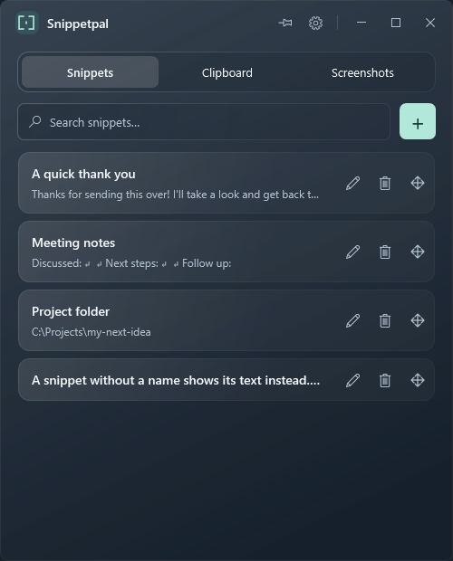

# Snippetpal

A small, glass-styled Windows app for the things you copy again and again.

Save snippets, click to copy, and keep your clipboard history, screenshots, and recordings close at hand. No account required.

<picture>
  <source media="(prefers-color-scheme: light)" srcset="docs/images/snippetpal-light.png">
  
</picture>

*App preview with sample snippets. The glass effect varies with your Windows version and desktop.*

## Download and install

**[Download Snippetpal for Windows](https://github.com/kolefield/Snippetpal/releases/latest)**

Open **Assets** on the release page and choose:

| Download | What to do |
| --- | --- |
| **Snippetpal-Setup-x64.exe** — recommended | Run the installer, then open Snippetpal from the Start menu. |
| **Snippetpal-win-x64.zip** — portable | Extract the ZIP to a folder and open `Snippetpal.exe`. No installation needed. |
| **Snippetpal.exe** | Run the app directly. |

Requires **Windows 10 or 11, 64-bit Intel/AMD**. Everything needed to run the app is included. Windows 11 22H2 or later provides the glass blur; older versions use a solid background.

This is an **early preview**, and the downloads are not yet digitally signed. Windows may show an unknown-publisher or SmartScreen warning. Download only from this repository's releases.

## Make it yours

- Click **+** to add a snippet. Give it a name, or let the text be its label.
- **Click a snippet to copy it.** Drag the four-way arrows on its right to change the order.
- Use **Clipboard** to find text you copied while Snippetpal was running.
- Use **Screenshots** for images and saved recordings. Win+Shift+S screenshots can arrive through the clipboard; Win+Shift+R recordings must be saved first. Set your capture folders in Settings if needed.
- Click the **pin** to keep Snippetpal above other windows. Light and dark mode follow Windows automatically, with overrides in Settings.

Closing the window keeps Snippetpal in the system tray. Press **Ctrl+Alt+S** to bring it back. To exit completely, right-click the tray icon and choose **Quit Snippetpal**.

## Updates, privacy, and removal

To update, quit Snippetpal from the tray, then run the latest installer or replace your portable files. Your saved snippets stay in place. Updates are currently manual.

Your data stays on your computer; there is no cloud sync or analytics. Snippet text and history metadata are encrypted for your Windows account. Cached clipboard images are stored as ordinary PNG files. Pause history in Settings whenever you need to.

Uninstall through **Windows Settings → Apps → Installed apps**. Your saved library is kept for reinstalling. **Settings → Data folder** shows where it lives. Removing a screenshot or recording from history does not delete your original file.

Need help? **[Report a problem](https://github.com/kolefield/Snippetpal/issues)**. Interested in building the app? See the [developer guide](docs/DEVELOPING.md).
